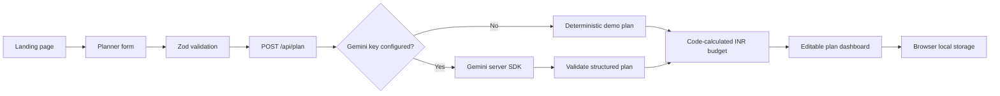

# Celebrate AI

Celebrate AI turns an event brief into an editable celebration plan with a timeline, budget, menu, invitation, guest RSVPs, and backup suggestions. The project is a Next.js App Router application designed to work in demo mode without credentials.

## Features

- Birthday, wedding, anniversary, baby shower, festival, corporate, farewell, and custom event planning
- Gemini generated plans through a server-only route, with schema validation and deterministic demo plans when no key is configured
- INR budget allocations calculated in code and guaranteed to sum to the entered budget
- Timeline task progress, budget overview, menu and decor, invitation text, guests, RSVP tracking, and backup suggestions
- Gemini prompted to generate English, Hindi, and Marathi plans when `GEMINI_API_KEY` is configured; demo mode uses bundled sample content
- Local browser draft and plan persistence, light and dark themes, and ICS generation utilities
- Responsive layout, keyboard focus styles, accessible toggle buttons, and reduced-motion support

Exports include plan JSON, guest CSV, and calendar ICS. PDF export is not currently implemented.

## Run locally

```sh
npm install
npm run dev
```

Open <http://localhost:3000>. The app works without an API key in Demo mode. For Gemini generation, copy `.env.example` to `.env.local` and set `GEMINI_API_KEY` (optionally set `GEMINI_MODEL`). Never expose the key with a `NEXT_PUBLIC_` variable.

## Checks

```sh
npm run lint
npm run typecheck
npm test
npm run test:coverage
npm run test:e2e
npm run build
```

Playwright uses Chrome if `PLAYWRIGHT_BROWSER_CHANNEL=chrome` is set and `PLAYWRIGHT_BASE_URL` can point it to a running local server. Otherwise it uses Playwright's bundled browser and `http://localhost:3000`.

## Architecture



## Security and privacy

See [SECURITY.md](SECURITY.md) for reporting and safeguards. Gemini calls stay on the server. Routes validate input, limit request size and per-IP request rates, and return generic server errors. A nonce-based Content Security Policy supports Next.js hydration. Event drafts and guest lists are stored in the current browser's local storage; do not enter sensitive information on shared devices.

## Project structure

- `app/`: routes, page UI, API handlers, and global styles
- `components/ui/`: reusable accessible controls
- `lib/ai/`: Gemini client and demo plan
- `lib/budget/`, `lib/dates/`, `lib/ics/`, `lib/storage/`, `lib/validation/`: business logic and schemas
- `tests/`: unit, API, and component tests
- `e2e/`: Playwright flows

## Deployment

The application is ready for a Next.js hosting provider such as Vercel. Configure `GEMINI_API_KEY` in the deployment environment. A public deployment URL has not been configured yet.
